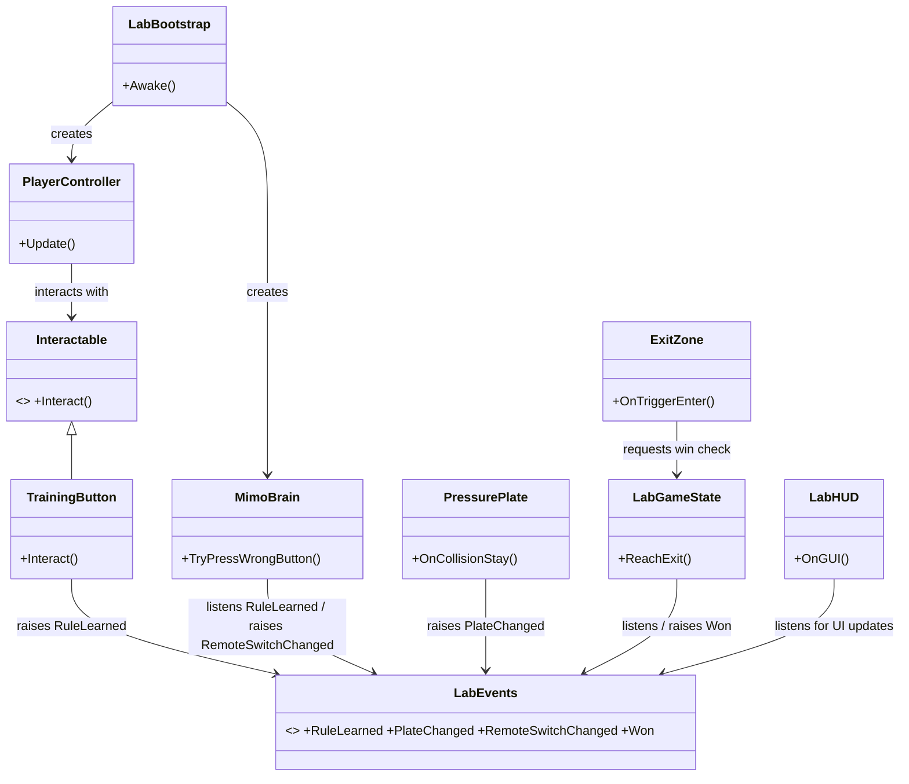

# The Game That Learns the Wrong Lessons - Prototype
> **Status:** Playable single-level prototype.

## Game concept and core loop

The player is trapped in a test laboratory with Mimo, a robot that generalizes the player's demonstrations incorrectly. The player demonstrates a button press on a blue button; Mimo concludes that **all blue buttons should be pressed**, walks to another blue button and presses it. Meanwhile the player uses a physics-based pushable box to activate a pressure plate. Both mechanisms must remain active to open the exit gate.

**Observe → Demonstrate → Mimo learns the wrong rule → Exploit the mistake → Use physics → Escape.**

This is a **single-level 3D greybox prototype** rather than the full four-level game, consistent with the assignment's allowance for one playable level and placeholder art.

## Requirements and setup

1. Open the existing **Unity 6** project (using the Universal Render Pipeline / URP). For a fresh setup, create a Unity 6 URP project.
2. Copy the supplied `Assets/Scripts` folder into your project's `Assets` folder.
3. Open the `LabPrototype` scene and ensure it is enabled under **Build Profiles → Scene List** (or **Build Settings → Scenes in Build**). For a fresh project, create the scene and add an active `LabBootstrap` GameObject.
4. Ensure the scene contains **one active `LabBootstrap` component**, then press **Play**. It generates the laboratory, player, Mimo, gameplay camera, controls, UI, walls, box, pressure plate, and exit at runtime. Avoid keeping a second active scene camera.
5. The level is presented from a fixed angled overhead **orthographic** camera; the player moves along the X/Z plane.
6. Keep the `RuntimeMaterial` material asset in `Assets/Resources/RuntimeMaterial.mat`, with a **Universal Render Pipeline/Lit** shader, so the bootstrap can load it at runtime.
7. Keep `Assets/link.xml` in the project to preserve dynamically used physics components in WebGL builds (see **WebGL build notes**).

**Controls:** **WASD** to move; **E** to interact with the training button or push the physics box while facing it and within reach; **R** to restart. The player keeps facing the last nonzero movement direction when stationary. Interaction uses a short SphereCast in that saved facing direction, rather than activating everything within a broad radius.

**Walkthrough:** Move to the **dark-blue spherical Training Button** near the left side, face it, and press E. Mimo walks to the **aqua spherical remote button** and activates it because it overgeneralized the lesson. Face the orange/brown physics box and push it with E toward the magenta pressure plate. When the box activates the plate and Mimo has activated the remote button, the exit gate opens. Walk through the opening to the green exit zone to win.

**Prototype scope:** This is a single playable 3D greybox level, not the full game.

## Physics used

| Assignment requirement | Implementation |
|---|---|
| CharacterController | `PlayerController` on player; movement with `CharacterController.Move` |
| Rigidbody | Pushable box has `Rigidbody` and gravity |
| AddForce | `PlayerController` pushes the box using `AddForce(..., ForceMode.Impulse)` |
| Raycast / SphereCast | `PlayerController` uses a short `Physics.SphereCast` along the last movement/facing direction to detect interactable objects |
| Collision | `PressurePlate` receives `OnCollisionEnter`, `OnCollisionStay`, `OnCollisionExit` |
| Optional joints/effectors | Not used (optional) |

## Project structure

```text
Assets/
  Scripts/
    Bootstrap/LabBootstrap.cs
    Player/PlayerController.cs
    Mimo/MimoBrain.cs
    World/Interactable.cs
    World/TrainingButton.cs
    World/PressurePlate.cs
    World/MimoTrigger.cs
    World/ExitZone.cs
    Game/LabEvents.cs
    Game/LabGameState.cs
    UI/LabHUD.cs
  Resources/RuntimeMaterial.mat  (URP material referenced at runtime)
  Scenes/LabPrototype.unity
  link.xml  (preserves runtime physics components for WebGL)
```

## Visual design and runtime generation

- **Player:** Green capsule with two eyes and pupils (no nose). The face is attached to the player visual and rotates toward the last movement direction, making orientation readable from the overhead camera.
- **Mimo:** Yellow capsule robot with an antenna (thin stem and colored tip), generated as part of its visual hierarchy.
- **Buttons:** Dark-blue training button and aqua remote button are both spherical primitives.
- **Puzzle objects:** Pushable rigidbody box, magenta pressure plate, exit gate, and exit trigger.
- **Scene generation:** `LabBootstrap` creates the laboratory and visual primitives at runtime. Restart regenerates the level rather than depending on an editor-authored layout.

## Architecture and class relationships



### Events

- `TrainingButton` raises `RuleLearned` → `MimoBrain` listens and moves to the remote button; `LabHUD` updates.
- `MimoBrain` raises `RemoteSwitchChanged(true)` → `LabGameState` listens and reevaluates the exit gate.
- `PressurePlate` raises `PlateChanged(true/false)` → `LabGameState` updates the gate; `LabHUD` updates the message.
- `LabGameState` raises `Won` → `LabHUD` displays the win message.

All event subscriptions made in `OnEnable` are removed in `OnDisable`. `LabEvents` is static only to provide a small prototype-wide event bus; for a larger game, replace it with an injected event channel or ScriptableObject event assets. `LabGameState.HasWon` is static for convenient read-only access by the movement controller, and is reset on level initialization.

### Architectural decisions

1. **Events instead of direct UI calls.** The gameplay systems never reference the HUD. The HUD subscribes to events, so UI can be redesigned without rewriting gameplay logic.
2. **Small components instead of one game manager.** Input/movement, learning behavior, physical plate, win conditions, and UI are separate classes, each with one primary responsibility.
3. **Tunable Inspector values instead of scattered magic numbers.** Movement speed, gravity, push force and interaction distance are serialized. Level layout constants remain in the bootstrap greybox and should become serialized level configuration or prefabs in production.

### How to extend

- To add a new teachable button, create another component derived from `Interactable` and publish a suitable event. The player controller does not need modification.
- To add a new Mimo learning rule, extend `MimoBrain` or (preferably for a full game) add separate rule components that listen to demonstrations.
- To add another exit condition, change `LabGameState` only; the HUD remains event-driven.
- To improve the level visually, replace the primitive creation in `LabBootstrap` with prefabs and authored scenes, leaving the gameplay components intact.

## WebGL build notes

The playable WebGL version exposed two issues that did not appear in the same way in the Unity Editor:

1. **Missing runtime shader:** Creating a material from a shader found only by name could result in a null shader reference in the build. The project now uses a `RuntimeMaterial` asset with a URP/Lit shader, loaded from `Assets/Resources/RuntimeMaterial.mat`. Keep that asset in the build.
2. **Missing collider types:** Browser logs reported `Can't add component because class 'CapsuleCollider' doesn't exist!` and similar `SphereCollider` messages. The generated primitives need these collider types at runtime. Adding `Assets/link.xml` to preserve the physics types resolved the reported WebGL gameplay failure, even though Managed Stripping Level was already set to Minimal.

Example `Assets/link.xml`:

```xml
<linker>
  <assembly fullname="UnityEngine.PhysicsModule">
    <type fullname="UnityEngine.BoxCollider" preserve="all"/>
    <type fullname="UnityEngine.SphereCollider" preserve="all"/>
    <type fullname="UnityEngine.CapsuleCollider" preserve="all"/>
    <type fullname="UnityEngine.Rigidbody" preserve="all"/>
    <type fullname="UnityEngine.CharacterController" preserve="all"/>
  </assembly>
</linker>
```

**Deployment:** Build for **Web/WebGL** in Unity, package the generated build files as required by itch.io, upload them as an HTML game, and test gameplay in the browser (movement, interaction, Mimo, box/plate, HUD, win, and restart). Keep `RuntimeMaterial.mat` and `link.xml` under version control.

## Links (fill in after publishing)

- GitHub repository: https://github.com/Gamedev-HW/The-Game-That-Learns-the-Wrong-Lessons
- itch.io WebGL game: https://gamedev-hw.itch.io/the-game-that-learns-the-wrong-lessons
